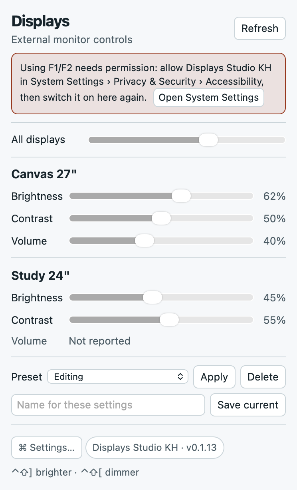
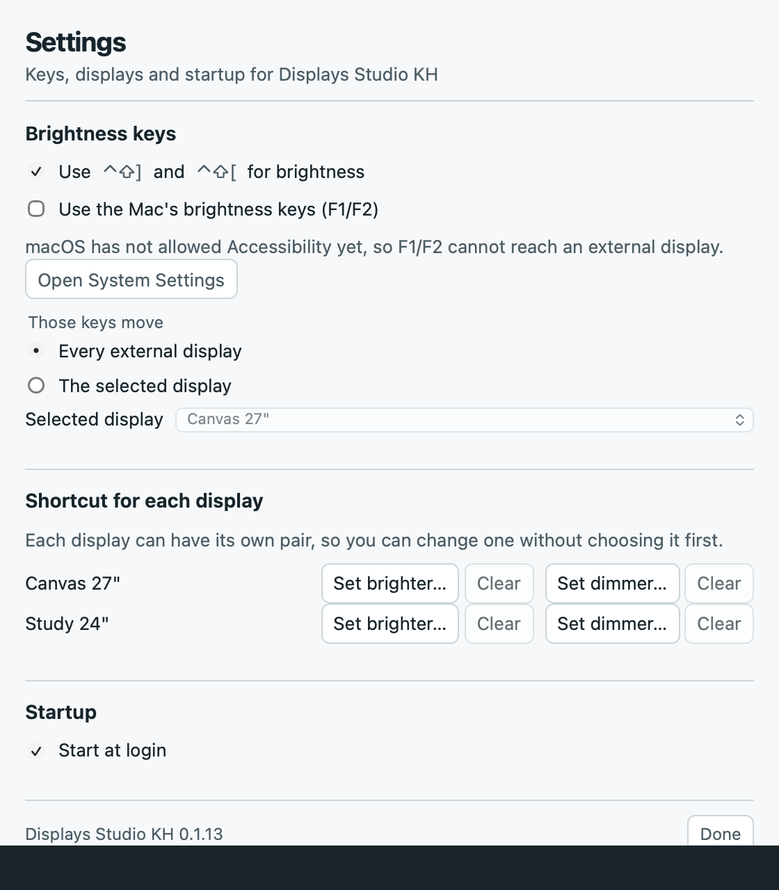

# Displays Studio KH

Control external monitor brightness from the Mac menu bar over DDC/CI. Contrast and monitor volume appear only when the display reports them. DisplayPort, HDMI, docks, and adapters vary: if a control is missing, check the monitor's DDC/CI setting and try a direct connection.

Click the menu-bar display icon to open the panel. The slider at the top moves every display together. Use **Control–Shift–]** or **Control–Shift–[** to step all supported displays by 5%, or switch on **Use the Mac's brightness keys (F1/F2)** to make the Mac's own brightness keys drive the external displays — that needs Accessibility permission, and the panel says so when it is missing. **Start at login** is on by default. Closing the panel does not quit the app; use **Quit Displays Studio KH** in the tray menu. The app doesn't poll or run a helper.

## Screenshots





Dark mode: [panel](docs/screenshots/panel-dark.png) · [Settings](docs/screenshots/settings-dark.png). Taken
from the build being released by `bash scripts/capture-screenshots.sh`, which renders the app's own
webviews in an isolated data directory with invented displays — no screen capture, no real device name.

## Local build

Use the macOS Tauri 2 toolchain. Take the shared studio app test lane before any build, probe, or hidden run. No launch is needed to build the crate.

```sh
cargo build --manifest-path src-tauri/Cargo.toml --locked --features custom-protocol
```

The Tauri configuration targets a macOS DMG. Use the Studio signing and release process before publishing; this checkout has no published build. Recreate `ui-shell/whats-new.json` with the Studio `whats-new.py` script whenever `CHANGELOG.md` changes.

## Local checks

`cargo test` in `src-tauri` checks level conversion and validates inputs without hardware. `cargo run --example probe` reads the hardware it actually finds. To check the embedded UI without taking the desktop, build with both `custom-protocol` and `webview-check`, then run `python3 -I scripts/verify-hidden.py src-tauri/target/debug/displays-studio-kh`. The current receipt fixture expects the connected MSI MP273. The check isolates app state and verifies the hidden pane, then samples idle with the pane closed.

Only the `webview-check` build accepts `--test-mode <dir>` (the same hidden isolated run as
`--webview-check <dir>`) and `--ddc-check 'MSI MP273'`. It reads the exact brightness on that monitor, changes it by one step, reads it back, and restores and verifies the original value. Run this only when authorized to change that display.

## Release

Build, sign and package here; the DMG then goes to this app's own GitHub release, and the appcast
item is written from the gated bytes:

```sh
bash scripts/build-mac.sh
```

`build-mac.sh` writes `dist/Displays Studio KH-<version>.dmg` signed with the shared KH identity.
1301 is not a release host (owner, 2026-11-23): App Publisher uploads the artifact to
`theng12/displays-studio-kh` and reports the download URL and sha256, and only then is the item
added to `appcast.xml` — the signed feed this app updates itself from.
